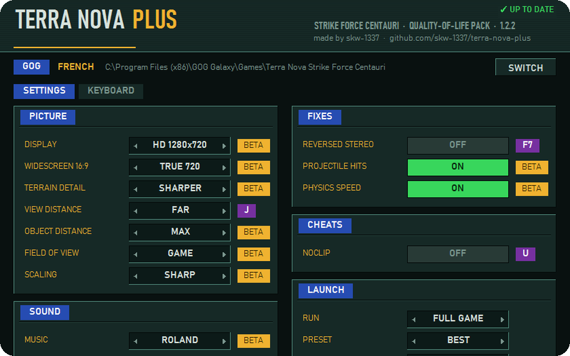
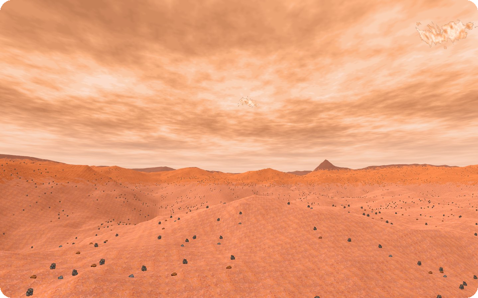
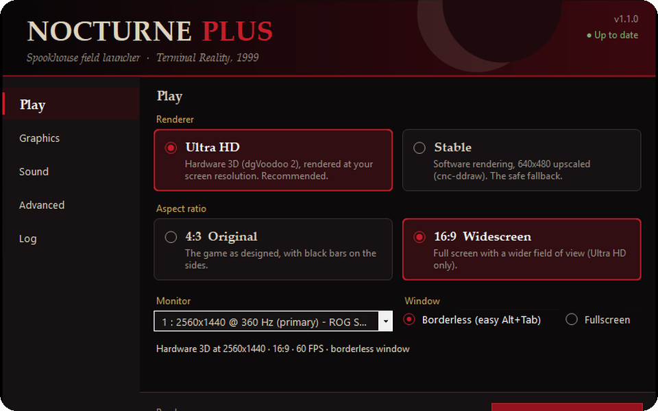
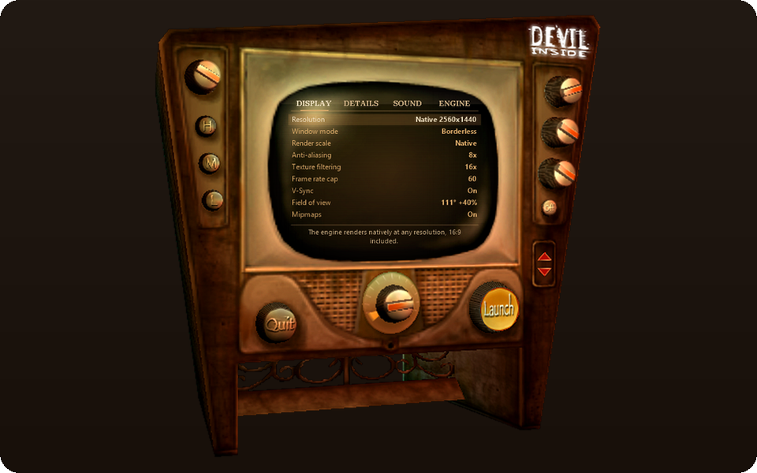

Mostly old PC games: DOS games in DOSBox, Windows games from around 2000, and small tools that do one job.

### Terra Nova: Strike Force Centauri (Looking Glass, 1996)

<table>
  <tr>
    <td width="50%" valign="top">
       
      <b><a href="https://github.com/skw-1337/terra-nova-plus">terra-nova-plus</a></b> 
      HD 1280x720 in true 16:9, mouse freelook, key remapping and bug fixes, from one launcher
    </td>
    <td width="50%" valign="top">
       
      <b><a href="https://github.com/skw-1337/terra-nova-uplink">terra-nova-uplink</a></b> 
      The game redrawn in modern 3D, to fly around every map, play it live, or play it with a friend online (prototypes), using your own game files
    </td>
  </tr>
</table>

And [terra-nova-freelook](https://github.com/skw-1337/terra-nova-freelook): just the freelook, if that's all you want.

Bugs, ideas, "doesn't work on my DOSBox": [discussions](https://github.com/skw-1337/terra-nova-plus/discussions).

### One launcher per game, for Windows games from around 2000

Rendered at your screen's resolution, real widescreen, engine bugs fixed, using your own game files.

<table>
  <tr>
    <td width="50%" valign="top">
       
      <b><a href="https://github.com/skw-1337/nocturne-plus">nocturne-plus</a></b> 
      Nocturne (Terminal Reality, 1999): Ultra HD hardware 3D, native 16:9, engine fixes, optional AI-remastered backgrounds
    </td>
    <td width="50%" valign="top">
       
      <b><a href="https://github.com/skw-1337/devil-inside-plus">devil-inside-plus</a></b> 
      The Devil Inside (Cryo, 2000): native resolution, widescreen field of view, the "runs 11× too fast" bug fixed, in the game's own vintage TV
    </td>
  </tr>
</table>

Also [lan](https://github.com/skw-1337/lan), a small invite-only planner for our online LAN nights (CS 1.6, WC3, AoE2).
